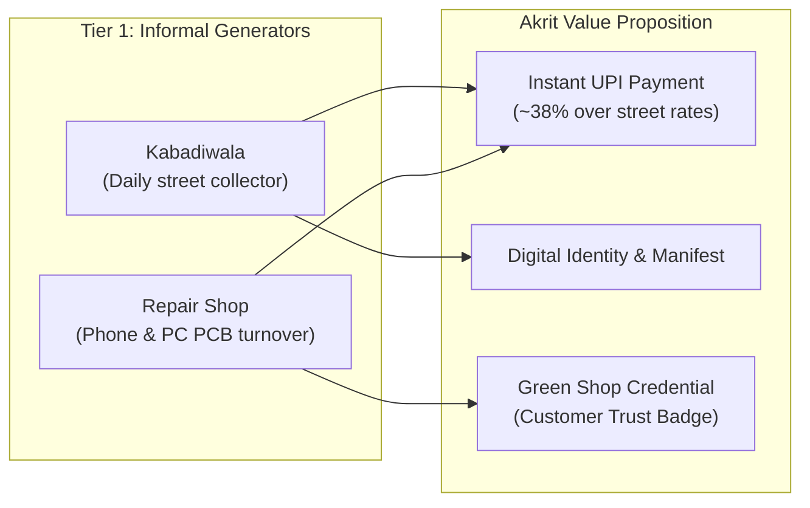

# Project Akrit — Comprehensive Project Dossier & System Architecture

> **"Think of Akrit like Zomato, but for e-waste.**  
> Zomato does not cook food or own restaurants — it owns the data, the tracking, and the trust. Akrit does not recycle e-waste or own trucks. It owns the digital manifest, the verified supply chain, and the connection between the informal waste workers who aggregate waste and the authorized recyclers registered to process it."

---

## 1. Executive Summary & Problem Statement

India is the **world's third-largest generator of electronic waste**, producing approximately **1.75 million metric tonnes** in FY 2023–24 (a ~75% surge over the preceding five years). Maharashtra is the single largest e-waste generating state in India, and the Mumbai Metropolitan Region is its top generating urban center.

```mermaid
graph TD
    A["Informal E-Waste Supply\n(Kabadiwalas & Repair Shops)\n>90% of 1.75M MT"] -->|Toxic processing / Street sales| B["Informal Middlemen & Scrap Yards\n(Fluctuating prices, Zero EPR credits)"]
    A -->|Akrit Mobile Web-App\n(Digital Manifest + GPS + QR)| C["Akrit Verification Layer"]
    C -->|Doorstep Tempo Pickup| D["MPCB-Authorized Recyclers\n(Ecoreco, Recyclekaro, Justdispose)"]
    D -->|Formal Weighing & CPCB Filing| E["CPCB EPR Credit Portal\n(Brands: Samsung, Apple, LG)"]
    E -->|UPI Direct Payout + Fair Rates| A
```

### The Crisis & The Regulatory Tailwind
- **90%+ Informal Sector Dominance:** Over 90% of India's e-waste is handled by kabadiwalas and repair shops using crude, hazardous open-burning and acid-bath methods.
- **Supply-Demand Disconnect:** Formal recycling facilities exist but starve for steady, predictable, and legally traceable supply.
- **The E-Waste (Management) Rules 2022 Mandate:** Electronics manufacturers (Samsung, Apple, LG, Xiaomi) must recycle **70% of prior-year sales** via CPCB-registered facilities in FY 2024–25 or face heavy Environmental Compensation penalties.
- **Guaranteed Value Floor:** CPCB's 2024 amendment established a floor price of **₹22 per kg** for consumer electronics EPR credits, fueling a domestic market estimated at **₹1.5 billion in 2025** and projected to reach **₹5 billion by 2030** (20% CAGR).

---

## 2. Who We Are Empowering — The Beneficiary Story



### The Kabadiwala's Reality vs. Akrit Transformation
- **Status Quo:** Travels 20–30 km daily on foot/cycle, sells mixed scrap to local aggregators at arbitrary markdown rates, has zero access to EPR credits, and faces toxic exposure without receipts or creditworthiness.
- **With Akrit:** Receives a transparent, guaranteed rate per kg (e.g., ₹40/kg phones, ₹85/kg circuit boards vs. ₹25 street aggregator rate). Instant UPI payment is recorded alongside a Digital Manifest, creating an auditable transaction history for future financial inclusion (micro-loans, insurance, government schemes).

### The Repair Shop Owner's Reality vs. Akrit Transformation
- **Status Quo:** Accumulates high-grade electronic scrap (broken logic boards, cracked phone assemblies, batteries, power supplies), and discards or sells it piecemeal to street scrap dealers.
- **With Akrit:** Schedules scheduled doorstep pickups from authorized recyclers with guaranteed weight scales. Earns the customer-facing **"Green Shop"** certificate and digital badge to display in-store, signaling environmental leadership to consumer clients.

---

## 3. Platform Model: The Three-Sided Marketplace

Akrit operates on zero capital expenditure for physical infrastructure. We do not own trucks or warehouses. We own the **data, the verification protocols, and the trust layer**.

| Stakeholder | System Role | What They Receive |
| :--- | :--- | :--- |
| **Waste Generator** *(Kabadiwala / Repair Shop)* | Logs waste batch via mobile web app | Guaranteed instant UPI payment + Green Certificate |
| **Logistics Partner** *(Local Tempo / Pickup Van)* | Picks up batch, verifies generator ID, scans QR | Fixed per-trip fee (e.g., Tata Ace / Mahindra Bolero) |
| **Authorized Recycler** *(MPCB-Certified Plant)* | Weighs at scale, confirms handover, files CPCB EPR data | Steady, legally documented, CPCB-compliant supply |
| **Brands / Compliance Officer** *(Samsung, Apple, etc.)* | Tracks quarterly recycling against targets | Audit-ready CPCB compliance reports & claimable EPR credits |

---

## 4. The Digital Manifest System: How Trust is Built

The centerpiece of every Akrit transaction is the **Digital Manifest** (e.g., `AKR-2611-MH-49210`). It contains:
1. **Timestamped Handover Record:** Exact time logged by generator and verified by recycler.
2. **Dual-Weight Accounting:** Generator logged weight vs. Recycler scale weight, with automatic tolerance checking (<10% threshold).
3. **Cryptographic QR Code:** Scannable in real-time by drivers, recyclers, or regulatory auditors to inspect the immutable manifest.
4. **Geo-Location Verification:** Handover GPS coordinate matching (e.g., Dharavi 19.043°N, 72.853°E).
5. **Tamper-Evident Status Stamp:** `Pending Confirmation`, `EPR Credit Eligible`, or `Flagged for Review`.

---

## 5. MPCB-Authorized Recycler Network (Mumbai Metropolitan Region)

To eliminate the documented risk of ghost plants (uncovered by national investigative reporting in 2025), Akrit maps generators to confirmed, physically authorized recyclers within 60–90 km of Mumbai's core waste generation nodes (Lamington Road, Dharavi, Kurla):

| Partner Recycler | Location | Authorization & Capacity | Fleet Deployed |
| :--- | :--- | :--- | :--- |
| **Eco-Recycling Ltd (Ecoreco)** | Vasai East, Dist. Palghar | MPCB Authorized — **7,200 MT/year** | Tata Ace (Sub-100 kg urban collection) |
| **Evergreen Recyclekaro India** | Wada, Dist. Palghar | ISO 14001, R2 Certified, CPCB Portal Registered | Tata Ace (Direct industrial aggregation) |
| **Justdispose Recycling Pvt Ltd** | Vasai East, Dist. Palghar | MPCB Authorized — **1,200 MT/year** | Mahindra Bolero pickup van |
| **E-Incarnation Recycling** | Tarapur, Dist. Palghar | MPCB Authorized — **950 MT/year** | Heavy tempo / multi-hub aggregation |

---

## 6. Sustainable Development Goals (SDG) Alignment

- **SDG 8: Decent Work and Economic Growth** — Formalizes daily-wage informal workers, elevates take-home earnings by ~38%, and establishes an economic paper trail for financial inclusion.
- **SDG 9: Industry, Innovation and Infrastructure** — Creates a digital supply chain and traceable urban mining conduit where no formal infrastructure previously existed.
- **SDG 12: Responsible Consumption and Production** — Diverts hazardous components (lead, cadmium, mercury, flame retardants) away from unscientific street burning into authorized closed-loop material recovery.

---

## 7. Mobile-First Web Application Architecture

The assembled application in `index.html` is engineered specifically for field use on low-cost smartphones and patchy 3G/4G connectivity:

```
projectakrit/
├── index.html                   # Fully assembled, standalone mobile-first web app
├── a_head.html                  # Design system stylesheet, fonts, scripts
├── b_core.js                    # Domain data, i18n, state store, PDF engine, sync
├── c_views.js                   # Views: Onboarding, Kabadiwala, Repair Shop, Manifests
├── d_views2.js                  # Views: Compliance Officer, Recycler Desk, Dispatcher
├── assemble.py                  # Build & assembly automation pipeline
└── PROJECT_AKRIT_DOCS.md        # Comprehensive project dossier & vision document
```

### Key Technical Highlights:
1. **Zero-Build Dependency:** Pure Vanilla ES6+, CSS3 Custom Properties, and zero npm build steps. Runs immediately in any mobile or desktop browser.
2. **Trilingual Support (i18n):** Instant switching between **English (EN)**, **Hindi (हिन्दी)**, and **Marathi (मराठी)**.
3. **Offline-First Synchronization:** Automatically queues manifests during network dropouts; detects online reconnection and transparently syncs with visual status indicators.
4. **Client-Side PDF & QR Generation:** Uses integrated `jsPDF` and `qrcode-generator` with native Blob-download fallbacks to generate compliant A4 certificates and reports directly on the user's device without server round-trips.
5. **Four Persona Experiences in One App:**
   - **Role 1 — Kabadiwala:** High-contrast, tactile UI with single-tap camera logging, 3-step intake, visual weight stepper, and instant earning comparison.
   - **Role 2 — Repair Shop Owner:** Green Shop certification tracker (5 verification milestones), component pickup scheduler, and exportable handover logs.
   - **Role 3 — Recycler Desk:** Digital weigh-scale input, delta tolerance detection, and one-tap anomaly flagging.
   - **Role 4 — Brand Compliance Officer:** Live EPR portfolio dashboard, interactive Mumbai geographic heat map, searchable manifests table, and 1-click CPCB compliance report generator.
   - **Vision Brief Modal:** Embedded executive summary and stakeholder breakdown accessible directly from the top navigation bar.

---

## 8. Quick Start & Testing Instructions

1. **Open the App:** Open `index.html` in any web browser (Chrome, Safari, Edge, Firefox) on desktop or mobile.
2. **Switch Roles:**
   - Click **"Switch role"** in the top bar to switch between Kabadiwala, Repair Shop, Compliance Officer, and Recycler Desk.
   - Or click **"Recycler desk"** to simulate confirming a delivery at an authorized recycler's weigh-scale.
3. **Explore the Project Vision:** Click **"Project Vision"** in the header to review the core idea, problem statement, MPCB partners, and SDG alignment.
4. **Test Offline Mode:** Click **"Test offline"** to simulate field conditions without internet; log a waste collection, observe local queuing, and re-enable to witness automated synchronization.
5. **Generate Real PDFs:** Open any manifest or go to Compliance Reports and click **"Save PDF"** or **"CPCB export"** to test native client-side PDF document generation.
